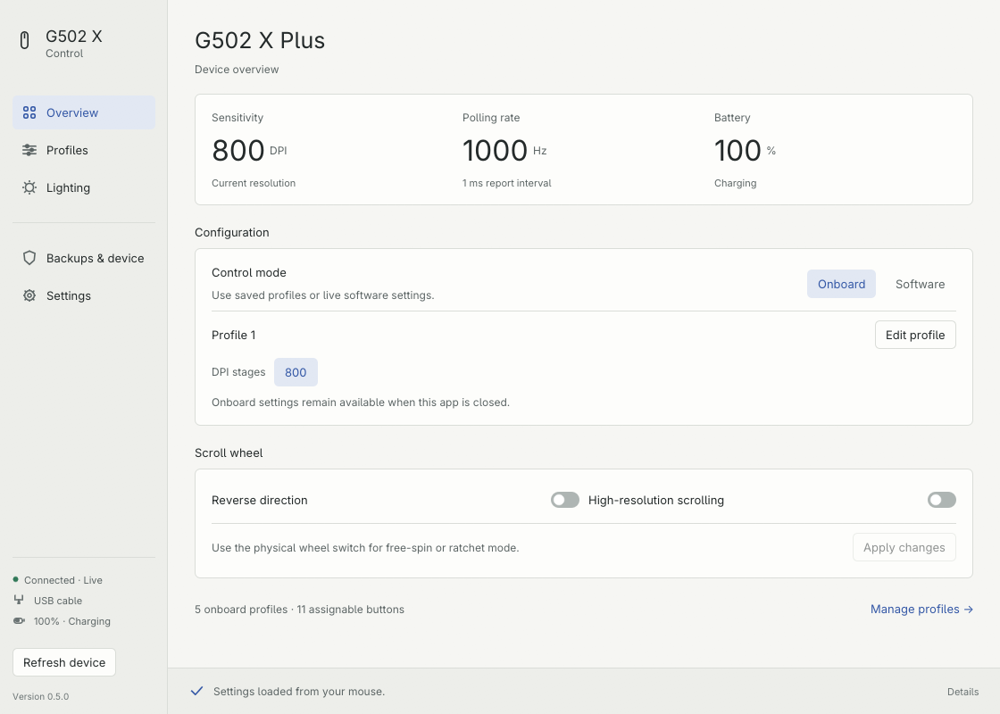

<div align="center">
  
  <h1>G502 X Control</h1>
  <p><strong>Your mouse. Your settings.</strong><br>A native, open-source control panel for the Logitech G502 X Plus, built in Rust.</p>
  <p>
    <a href="https://github.com/efaraz27/g502x-control/releases/latest"></a>
    <a href="https://github.com/efaraz27/g502x-control/actions/workflows/build.yml"></a>
    <a href="LICENSE"></a>
  </p>
  <p><a href="#install">Download</a> · <a href="#features">Features</a> · <a href="docs/GUIDE.md">User guide</a> · <a href="CONTRIBUTING.md">Contribute</a></p>
</div>



Configure sensitivity, buttons, lighting, and onboard profiles in one focused desktop app. No account, telemetry, or subscription. Optional background monitoring keeps battery alerts available after you close the window. Your saved onboard settings stay with the mouse.

> **Compatibility:** Linux has been tested with a real G502 X Plus over USB and LIGHTSPEED. Windows and macOS have native backends and automated builds, but physical-device support is **experimental**. This app supports the **G502 X Plus** specifically; other G502 models are not interchangeable.

## Install

No Rust toolchain is needed for the downloads below. Get the latest builds from [Releases](https://github.com/efaraz27/g502x-control/releases/latest).

| Platform | Download | Install |
| --- | --- | --- |
| Windows 10/11, 64-bit | [Setup.exe](https://github.com/efaraz27/g502x-control/releases/latest/download/g502x-control-windows-x86_64-setup.exe) | Open the setup wizard. Installs for your user, without administrator access. |
| macOS 13+, Apple Silicon | [Apple Silicon DMG](https://github.com/efaraz27/g502x-control/releases/latest/download/g502x-control-macos-aarch64.dmg) | Open the disk image and drag **G502 X Control** to **Applications**. |
| macOS 13+, Intel | [Intel DMG](https://github.com/efaraz27/g502x-control/releases/latest/download/g502x-control-macos-x86_64.dmg) | Open the disk image and drag **G502 X Control** to **Applications**. |
| Ubuntu 22.04+ / Debian 12+, 64-bit | [Linux .deb](https://github.com/efaraz27/g502x-control/releases/latest/download/g502x-control-linux-x86_64.deb) | Open with your package manager, or use the command below. |
| Linux ARM64 | [ARM64 .deb](https://github.com/efaraz27/g502x-control/releases/latest/download/g502x-control-linux-aarch64.deb) | For Debian/Ubuntu on ARM64. |
| Other modern Linux desktops | [x86-64 tar.gz](https://github.com/efaraz27/g502x-control/releases/latest/download/g502x-control-linux-x86_64.tar.gz) · [ARM64 tar.gz](https://github.com/efaraz27/g502x-control/releases/latest/download/g502x-control-linux-aarch64.tar.gz) | Use the installer below, or extract and run `sh install.sh`. Requires glibc 2.35+. |

**Linux — quick install**

```sh
curl -fsSL https://raw.githubusercontent.com/efaraz27/g502x-control/main/install.sh | sh
```

The [installer source](install.sh) downloads the latest binary, verifies its SHA-256 checksum, and adds an application-menu entry. It installs under `~/.local` and does not request root. If mouse permissions are missing, it prints the one-time udev setup commands. Re-run it to update.

For Debian/Ubuntu, the package also installs the device-access rule:

```sh
sudo apt install ./g502x-control-linux-x86_64.deb
# Reconnect the USB cable or receiver after installation.
```

**Windows / Mac first launch**

Releases are currently unsigned by a commercial publisher; macOS bundles use an ad-hoc signature and are not notarized. Windows may show SmartScreen, and macOS may require approval in **System Settings → Privacy & Security → Open Anyway**. Only approve a download you trust. See [Apple's guidance](https://support.apple.com/102445). Signing and notarization are tracked as release improvements.

A [portable Windows ZIP](https://github.com/efaraz27/g502x-control/releases/latest/download/g502x-control-windows-x86_64.zip) is also available. Close G HUB or other mouse-configuration apps before making changes. No replacement kernel driver is installed on any platform.

## Features

- **Five onboard profiles** — rename, enable, save and activate; keep your setups in the mouse.
- **Sensitivity** — five DPI stages, default/shift DPI, polling rate and live controls.
- **Button assignments** — visual editor for eleven hardware positions, standard and G-Shift layers, mouse buttons, keyboard shortcuts, media keys and device actions.
- **Lighting** — profile effects, live RGB and eight individually configurable LED segments.
- **Wheel and power** — wheel direction, high-resolution scrolling, dim/sleep fields and angle snapping.
- **Backups** — automatic full-memory backup before every flash save or restore; import/export individual profiles.
- **Live device data** — automatic readings every two seconds, reconnect handling, and protected unsaved drafts.
- **Tray & startup** — optional windowless battery monitor; launch quietly when you sign in, reopen the control panel from the tray.
- **Battery alerts** — native desktop notifications at a configurable threshold (20% by default), without repeated low-battery reminders.
- **Native UI + CLI** — responsive Rust interface, keyboard-accessible controls, file pickers and scriptable commands.

The app opens in read-only mode. Profile edits remain drafts until **Save to mouse**. Live controls have explicit apply buttons. Full restores require confirmation and create a backup first.

### Scope

This is an early independent project, not a complete G HUB replacement. It preserves existing macro and animation bytes but does not author multi-step macros, upload custom animations, auto-switch by application, update firmware or pair receivers. Hardware DPI-shift/G-Shift behavior depends on the saved mappings. Advanced firmware fields and every possible button binding have not all been behaviorally tested. [Validation details →](VALIDATION.md)

## Getting started

1. Connect your G502 X Plus by cable or its LIGHTSPEED receiver.
2. Launch the app. **Overview** shows connection, battery, DPI and polling rate.
3. Open **Profiles**, select a slot, and edit **Sensitivity**, **Buttons**, **Lighting** or **Power**.
4. Choose **Save to mouse**, then **Activate profile** when ready.

Use **Software** mode for live DPI/rate/lighting, and **Onboard** for saved profiles. Live settings can reset after reconnecting, sleeping or switching modes. The UI updates automatically; live controls are never reapplied automatically. Open **Settings** to change the refresh interval, battery threshold, tray monitor, or launch-at-login option. Background monitoring and startup are off by default.

[Full user guide and troubleshooting](docs/GUIDE.md) · [CLI examples](docs/CLI.md)

## Build from source

Install [Rust](https://rustup.rs), clone this repository, then:

```sh
git clone https://github.com/efaraz27/g502x-control.git
cd g502x-control
cargo build --release --locked
cargo test --locked
```

The repository pins its toolchain. Linux needs the normal development libraries for Wayland/X11, xkbcommon and OpenGL; Windows needs the MSVC build tools; macOS needs the Xcode command-line tools. See [CONTRIBUTING.md](CONTRIBUTING.md) for exact commands and packaging.

## How it works

The app uses HID++ through Linux hidraw, Windows native HID, and shared-access macOS HIDAPI. Normal pointer input continues through the operating system. Device identity and checksums are verified; untouched profile bytes are preserved; writes are read back. A process lock serializes this app's device operations. Physical disconnects can still interrupt a multi-sector flash write, so keep the mouse connected during saves.

Protocol work references [Logitech's HID++ documentation](https://github.com/Logitech/cpg-docs), [Solaar](https://github.com/pwr-Solaar/Solaar) and [libratbag](https://github.com/libratbag/libratbag). See [NOTICE](NOTICE) for attribution and [the architecture notes](docs/ARCHITECTURE.md) for the source layout.

## Contributing

Bug reports, accessibility improvements and physical Windows/Mac testing are welcome. Start with [CONTRIBUTING.md](CONTRIBUTING.md). Please remove device serial numbers, unit IDs and personal paths from public diagnostics; never attach full mouse backups to an issue.

Licensed under **GPL-2.0-or-later**. Fonts and dependencies retain their respective licenses. Unofficial community software; not affiliated with or endorsed by Logitech.
