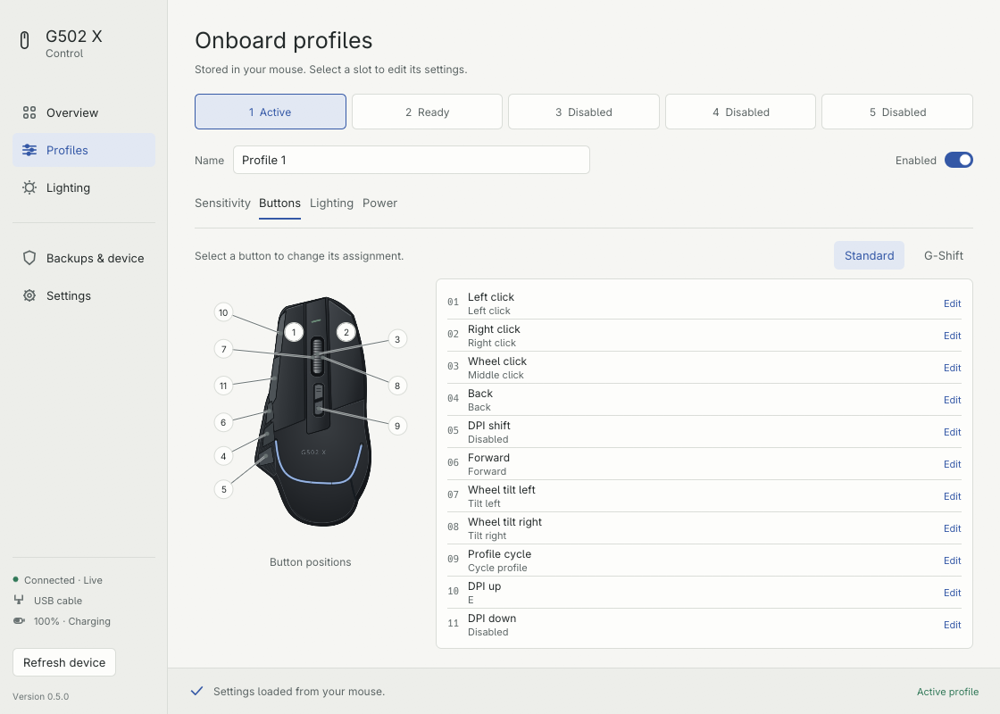
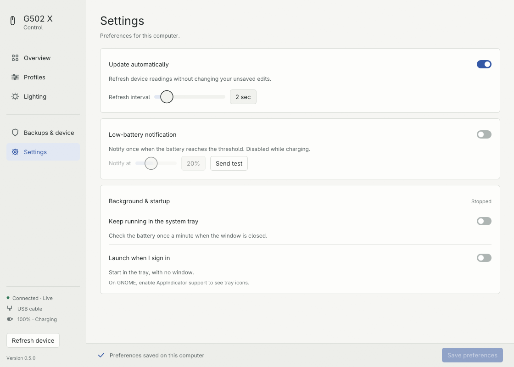

# User guide

## Profiles and live settings

**Profiles** edits the mouse's five onboard slots. Changes stay in the draft until **Save to mouse**. **Activate profile** switches to a saved enabled slot and onboard mode. Save or discard edits before choosing another slot. Blank names for factory profiles are displayed as “Profile 1”, etc., without rewriting vendor bytes.

The **Buttons** tab has standard and G-Shift layers. Select a numbered marker or assignment row. Numbers represent hardware storage positions, not Logitech's printed G-button labels. USB HID keyboard usages follow the operating system's keyboard layout. Unknown existing bindings remain unchanged until you replace them.



**Lighting** on the main sidebar applies live software-mode effects. **Profiles → Lighting** saves an onboard effect. Illustrations show your draft, not a readback of the LEDs. Individual LED colors cannot be read from the firmware. Live controls may reset on sleep, reconnect, profile activation or mode changes.

**Power** contains firmware fields for dim/sleep timeouts and angle snapping. Their behavior varies with firmware and operating mode. Physical testing has not covered every combination.

## Live updates, tray and battery alerts

**Settings** is available even when the mouse is disconnected. Choose **Save preferences** after changing an option.



- **Update automatically** defaults to every 2 seconds (adjustable from 1–10). Battery, DPI, rate, active profile, mode and wheel status update live. Complete onboard profiles refresh every 30 seconds. Polling only reads; it does not reapply your settings or write flash.
- Unsaved profile edits, open button editors and pending live inputs are preserved. If a saved profile changes elsewhere while you edit, the original conflict check still prevents overwriting it. Discard the draft to load the latest version before trying again.
- A **Reconnecting…** status marks stale data when the mouse sleeps or disconnects. The app retries automatically, backing off to 30 seconds. Wake the mouse to reconnect; **Refresh device** can also request a fresh read.
- **Battery alerts** default to 20% (adjustable from 5–50%). They use your OS notification center. An alert is rearmed after charging or recovering at least 5 percentage points above the threshold, with a 10-minute cooldown. Delivery state survives restarts and is shared by the window and background monitor. Charging and invalid readings do not trigger alerts.
- **Keep running in the system tray** starts a separate lightweight process that checks battery once a minute after you close the window. Its menu shows battery/connection status and offers **Open G502 X Control**, **Settings**, and **Quit background monitor**. Reopening focuses the existing control-panel window.
- **Launch when I sign in** also enables the tray monitor. It starts without a window for your user account: XDG autostart on Linux, a LaunchAgent on macOS, and the current-user Run key on Windows. Enable it from the installed app at its permanent location. Install the Mac app in Applications first. Turning off background monitoring also turns off startup.

Background monitoring and startup are opt-in. **Quit monitor for now** stops the current session while keeping your startup preference. Opening the app again starts the monitor if the background preference is enabled. Disable the background option and save to stop it persistently.

On Linux, the tray uses StatusNotifierItem (KDE, Waybar and compatible panels). GNOME may require the AppIndicator/KStatusNotifierItem extension; alerts still work without a visible tray. Minimal window-manager sessions must run XDG autostart for login launch. On any platform, **Send test** checks delivery to the OS; Do Not Disturb, notification permissions and desktop settings control whether a banner or sound appears. Windows/macOS notifications and tray behavior still need physical platform validation.

Preferences and alert history are stored beside the `backups` folder below. `monitor status` reports the background process and its latest check. No device access requires an administrator account once Linux's udev rule is installed.

## Backups

A complete backup is created before each flash save and full restore. Use **Backups & device → Create backup** to save one manually. Automatic backup folders:

| OS | Folder |
| --- | --- |
| Linux | `${XDG_STATE_HOME:-~/.local/state}/g502x-control/backups/` |
| Windows | `%LOCALAPPDATA%\g502x-control\backups\` |
| macOS | `~/Library/Application Support/g502x-control/backups/` |

Keep copies of important backups somewhere safe. Full backups include device identifiers, profile data, existing macros and animation bytes; avoid publishing them. Restore accepts a backup for the same device identity and geometry only. Every restore first backs up the current memory. Files are never overwritten.

The file chooser is built in on Windows/macOS. Linux uses `zenity` when installed; a full-path field and drag-and-drop fallback are always available. Importing a profile creates a draft. Restoring full memory has an explicit confirmation dialog.

## Connection troubleshooting

1. Verify the mouse is a **G502 X Plus**, powered on, and connected by USB cable or its paired LIGHTSPEED receiver.
2. Close G HUB, Solaar, Piper, or other mouse-configuration apps. Ordinary mouse input can continue.
3. Wake the mouse and allow automatic reconnection, or click **Refresh device**. Try the cable if wireless communication fails.
4. On Linux, install the device-access rule if the app reports permission denied. The `.deb` includes it; reconnect after installation. For the per-user installer:

   ```sh
   sudo install -m644 "$HOME/.local/share/g502x-control/70-g502x-control.rules" /etc/udev/rules.d/
   sudo udevadm control --reload-rules
   ```

   Reconnect the device. Run the GUI as your ordinary user, not root.

5. On macOS, check **Privacy & Security → Input Monitoring** if access is denied. The backend opens the device in shared mode; it does not seize the pointer.
6. Use `g502x-control list` and `g502x-control check` for read-only diagnostics. Redact unit IDs and serials before sharing.

Windows/macOS device communication is experimental until real hardware validation is available. An empty device list or timeout on these platforms is useful to report with OS version and connection type.

## Updating and uninstalling

Before replacing or removing the app, close the window and quit the tray monitor. Before uninstalling on Linux/macOS, turn off background monitoring in Settings and save, or run `g502x-control monitor stop`; this also removes login startup. The Windows and per-user Linux installers stop the monitor during upgrades and restart it if already enabled. Windows also removes its startup entry during uninstall.


- **Windows:** run the newer setup wizard. Uninstall through Installed apps. Backups are retained.
- **macOS:** quit the app, then replace it in Applications with the newer version. Drag the app to Trash to uninstall. Backups are retained.
- **Linux .deb:** install the new package with `sudo apt install ./downloaded-file.deb`. Uninstall with `sudo apt remove g502x-control`.
- **Linux per-user:** re-run the quick installer. To uninstall, remove `~/.local/bin/g502x-control`, `~/.local/share/applications/g502x-control.desktop`, `~/.local/share/icons/hicolor/scalable/apps/g502x-control.svg` and `~/.local/share/g502x-control/`. If you manually installed the udev rule, you can remove that rule separately. Backups are stored elsewhere and remain intact.

Startup entries are created only when you enable the option. Onboard settings remain in the mouse after uninstalling.
